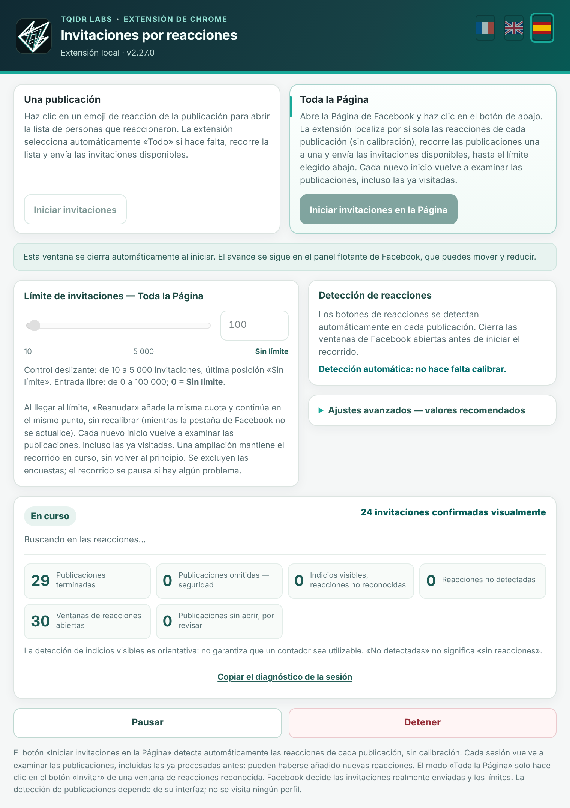
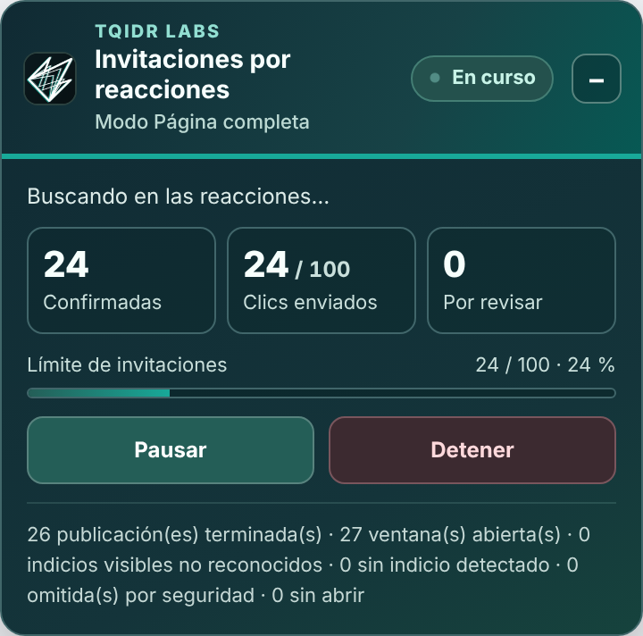

# TQIDr Labs Reaction Inviter

[English](README.md) | [Français](README.fr.md) | **Español**

Extensión de Chrome que invita, desde una Página de Facebook que administras, a las personas que reaccionaron a tus publicaciones a que den «Me gusta» a la Página. Recorre las publicaciones, abre la ventana de reacciones y hace clic en «Invitar» por cada persona que aún no ha sido invitada.

  
  

> **Proyecto independiente.** Esta extensión no está afiliada, aprobada ni patrocinada por Meta o Facebook. «Facebook» es una marca de Meta Platforms, Inc., citada aquí solo para describir la función.

## Advertencia importante

- Facebook puede limitar o suspender una cuenta que envía muchas invitaciones, y sus condiciones de uso regulan las automatizaciones. **La usas bajo tu propio riesgo**, con moderación. El autor no se hace responsable de las consecuencias.
- Objetivo razonable: **100 invitaciones al día** (límite por defecto). Los días de mucha actividad, 100 ya cubre a mucha gente; los días tranquilos, la extensión vuelve hacia publicaciones más antiguas.
- Detente ante cualquier mensaje de restricción de Facebook.
- La extensión no intenta imitar un comportamiento humano ni evadir detecciones: actúa sobre la página visible, a la vista, con un retraso ajustable.

## Funcionamiento

- Dos modos: **Una publicación** o **Toda la Página** (recorrido automático del feed).
- Interfaz en **español, inglés y francés**: banderas en la parte superior de la ventana emergente (por defecto, el idioma de Chrome).
- Detección automática, sin calibración.
- Cada inicio vuelve a comprobar las publicaciones sin memorizar nada: pueden haber llegado nuevas reacciones. Las personas ya invitadas se omiten.
- **Elegir la publicación de partida:** en el modo «Toda la Página», abre primero la ventana de reacciones de la publicación por la que quieres empezar y luego inicia el recorrido desde la ventana emergente. La extensión cierra la ventana, procesa esa publicación y continúa con las siguientes. Sin ninguna ventana abierta, el recorrido empieza en la primera publicación cargada en la página.
- Seguridad: no se envía ningún clic mientras la ventana no se reconozca como una auténtica ventana de reacciones; solo se pulsan los botones «Invitar» de esa ventana.
- Pausa, parada, límite ajustable, contadores y panel de seguimiento en la página.

## Instalación (modo desarrollador)

1. Descarga el zip de la última versión en la pestaña **Releases** (columna derecha) y descomprímelo.
2. Abre `chrome://extensions` y activa el **modo desarrollador**.
3. Pulsa **Cargar descomprimida** y elige la carpeta que contiene `manifest.json`.
4. Abre tu Página de Facebook (con Facebook en español, inglés o francés), pulsa el icono de la extensión e inicia.

Si tenías instalada una versión anterior, desactívala primero para evitar dos instancias.

## Privacidad

No se envía ningún dato por Internet y no se memoriza ninguna publicación ni ningún nombre. Solo se guardan en Chrome ajustes locales (retraso, límite, idioma elegido).

## Soporte y diagnóstico

Si hay un problema, abre la ventana emergente, pulsa **«Copiar el diagnóstico de la sesión»** (disponible incluso sin error) y pega el resultado en una *issue*. El informe contiene contadores, información técnica (versión de Chrome, idioma, tamaño de ventana) y estructuras de página anonimizadas, sin nombres, perfiles ni textos de publicaciones. Revísalo antes de publicarlo.

## Limitaciones conocidas

- Probada en condiciones reales en Facebook en **español**, **inglés** y **francés**. Los demás idiomas de Facebook no son compatibles por ahora (la detección se basa en etiquetas concretas). Facebook cambia a menudo su página: una actualización puede romper la detección (el diagnóstico ayuda a corregirlo).
- Ventana de categoría única sin pestañas: prevista, pero poco comprobada en condiciones reales.

## Historial

[CHANGELOG.md](CHANGELOG.md) (en francés)

## Licencia

[MIT](LICENSE) — © 2026 TQIDr Labs. El logotipo y el nombre TQIDr Labs siguen siendo propiedad de su autor.
