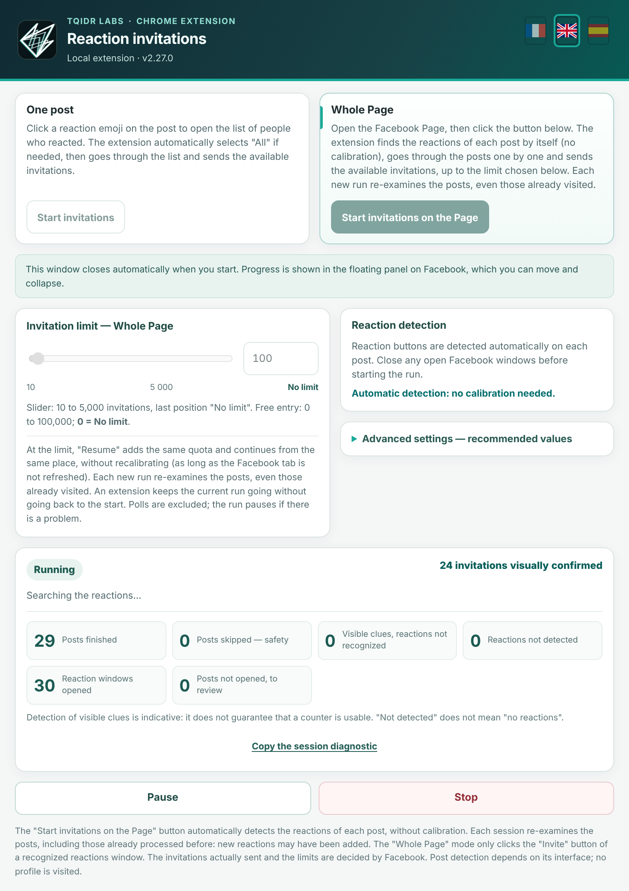
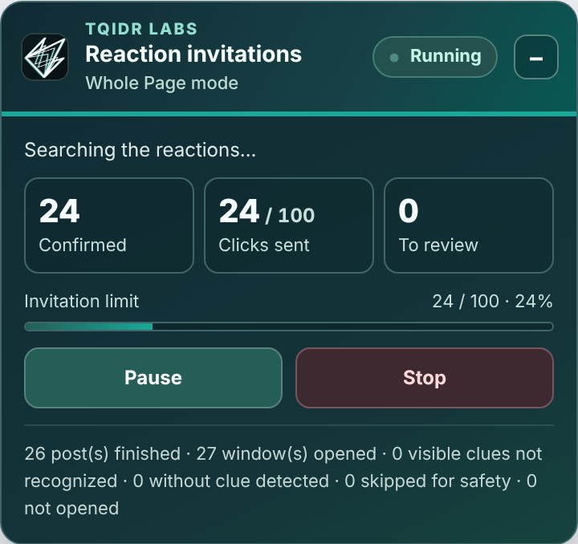

# TQIDr Labs Reaction Inviter

**English** | [Français](README.fr.md) | [Español](README.es.md)

Chrome extension that invites, from a Facebook Page you manage, the people who reacted to your posts to like the Page. It goes through your posts, opens the reactions window and clicks "Invite" for each person not yet invited.

  
  

> **Independent project.** This extension is not affiliated with, endorsed by or sponsored by Meta or Facebook. "Facebook" is a trademark of Meta Platforms, Inc., used here only to describe what the extension does.

## Important warning

- Facebook may limit or suspend an account that sends many invitations, and its terms of use restrict automation. **You use this extension at your own risk**, and with moderation. The author is not responsible for the consequences.
- Reasonable goal: **100 invitations per day** (default limit). On busy days 100 already covers a lot of people; on quiet days the extension goes back to older posts.
- Stop at the first restriction message from Facebook.
- The extension does not try to imitate human behavior or to evade detection: it acts on the page you see, visibly, with an adjustable delay.

## How it works

- Two modes: **One post** or **Whole Page** (automatic run through the feed).
- Interface in **English, French and Spanish**: flags at the top of the popup (by default, Chrome's language).
- Automatic detection, no calibration.
- Each run re-checks the posts without remembering anything: new reactions may have arrived. People already invited are skipped.
- **Choosing the starting post:** in "Whole Page" mode, first open the reactions window of the post you want to start from, then start the run from the popup. The extension closes the window, processes that post, then continues with the following ones. With no window open, the run starts at the first post loaded on the page.
- Safety: no click is sent until the window is recognized as a genuine reactions window; only the "Invite" buttons of that window are clicked.
- Pause, stop, adjustable limit, counters and a progress panel on the page.

## Installation (developer mode)

1. Download the zip of the latest version from the **Releases** tab (right-hand column) and unzip it.
2. Open `chrome://extensions` and turn on **Developer mode**.
3. Click **Load unpacked**, then choose the folder that contains `manifest.json`.
4. Open your Facebook Page (with Facebook set to English, French or Spanish), click the extension icon, start.

If an older version is installed, disable it first to avoid two instances.

## Privacy

No data is sent over the Internet, and no post or name is stored. Only local settings (delay, limit, chosen language) are kept in Chrome.

## Support and diagnostics

If something goes wrong, open the popup, click **"Copy the session diagnostic"** (available even without an error) and paste the result into an *issue*. The report contains counters, technical information (Chrome version, language, window size) and anonymized page structures, with no names, profiles or post texts. Review it before posting.

## Known limitations

- Tested on real Facebook in **English**, **French** and **Spanish**. Other Facebook languages are not supported for now (detection relies on specific labels). Facebook changes its pages often: an update may break detection (the diagnostic helps fix it).
- Single-category window with no tabs: planned for, but little checked in real conditions.

## History

[CHANGELOG.md](CHANGELOG.md) (in French)

## License

[MIT](LICENSE) — © 2026 TQIDr Labs. The TQIDr Labs logo and name remain the property of their author.
