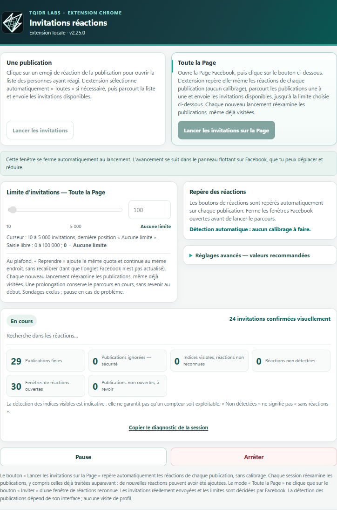
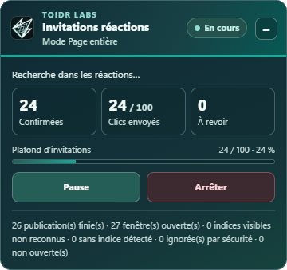

# TQIDr Labs Reaction Inviter

Extension Chrome qui invite, depuis une Page Facebook que vous administrez, les personnes ayant réagi à vos publications à aimer la Page. Elle parcourt les publications, ouvre la fenêtre des réactions et clique sur « Inviter » pour chaque personne pas encore invitée.

*English: a Chrome extension that goes through your Facebook Page's posts and sends the "Invite" button to each person who reacted. Interface and messages are in French; diagnostics work in French and English labels.*

  
  

> **Projet indépendant.** Cette extension n'est ni affiliée, ni approuvée, ni parrainée par Meta ou Facebook. « Facebook » est une marque de Meta Platforms, Inc., citée ici uniquement pour décrire la fonction.

## Avertissement important

- Facebook peut limiter ou suspendre un compte qui envoie beaucoup d'invitations, et ses conditions d'utilisation encadrent les automatisations. **Vous l'utilisez à vos risques**, avec modération. L'auteur n'est pas responsable des conséquences.
- Objectif raisonnable : **100 invitations par jour** (plafond par défaut). Les jours de forte activité, 100 couvre déjà beaucoup de monde ; les jours calmes, l'extension remonte vers les publications plus anciennes.
- Arrêtez-vous au moindre message de restriction de Facebook.
- L'extension ne cherche pas à imiter un comportement humain ni à échapper à des détections : elle agit sur la page affichée, visiblement, avec un délai réglable.

## Fonctionnement

- Deux modes : **Une publication** ou **Toute la Page** (parcours automatique du fil).
- Détection automatique, aucun calibrage.
- Chaque lancement recontrôle les publications sans rien mémoriser : de nouvelles réactions ont pu arriver. Les personnes déjà invitées sont ignorées.
- **Choisir la publication de départ :** en mode « Toute la Page », ouvrez d'abord la fenêtre des réactions de la publication par laquelle vous voulez commencer, puis lancez le parcours depuis la popup. L'extension referme la fenêtre, traite cette publication, puis poursuit avec les suivantes. Sans fenêtre ouverte, le parcours commence à la première publication chargée sur la page.
- Sécurité : aucun clic n'est envoyé tant que la fenêtre n'est pas reconnue comme une vraie fenêtre de réactions ; seuls les boutons « Inviter » de cette fenêtre sont cliqués.
- Pause, arrêt, plafond réglable, compteurs et panneau de suivi sur la page.

## Installation (mode développeur)

1. Téléchargez le zip de la dernière version dans l'onglet **Releases** (colonne de droite) et décompressez-le.
2. Ouvrez `chrome://extensions`, activez le **mode développeur**.
3. **Charger l'extension non empaquetée**, puis choisissez le dossier qui contient `manifest.json`.
4. Ouvrez votre Page Facebook (en français), cliquez sur l'icône de l'extension, lancez.

Si vous aviez une ancienne version installée, désactivez-la d'abord pour éviter deux instances.

## Confidentialité

Aucune donnée n'est envoyée sur Internet, aucune publication ni aucun nom n'est mémorisé. Seuls des réglages locaux (délai, plafond) sont conservés dans Chrome.

## Support et diagnostic

En cas de problème, ouvrez la popup, cliquez sur **« Copier le diagnostic de la session »** (disponible même sans erreur) et collez le résultat dans une *issue*. Le rapport contient des compteurs, des informations techniques (version de Chrome, langue, taille de fenêtre) et des structures de page anonymisées, sans noms, profils ni textes de publications. Relisez-le avant de le publier.

## Limites connues

- Testée sur l'interface française de Facebook ; Facebook modifie souvent sa page, une mise à jour peut casser la détection (le diagnostic aide à corriger).
- Fenêtre à catégorie unique sans onglets et libellés anglais : prévus mais peu vérifiés en conditions réelles.

## Historique

[CHANGELOG.md](CHANGELOG.md)

## Licence

[MIT](LICENSE) — © 2026 TQIDr Labs. Le logo et le nom TQIDr Labs restent la propriété de leur auteur.
